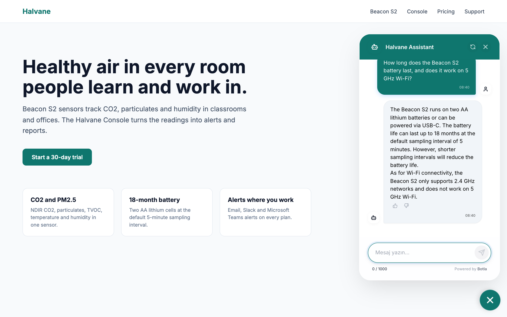
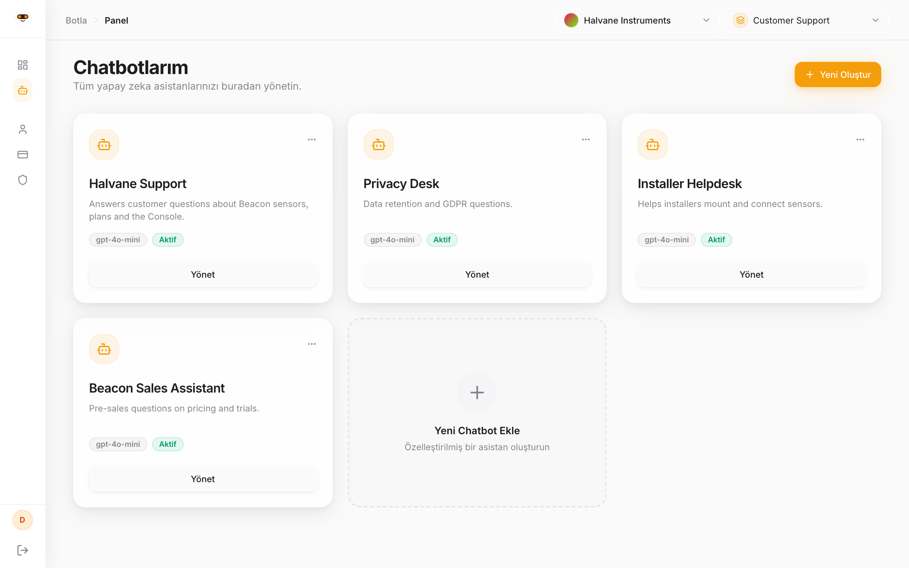
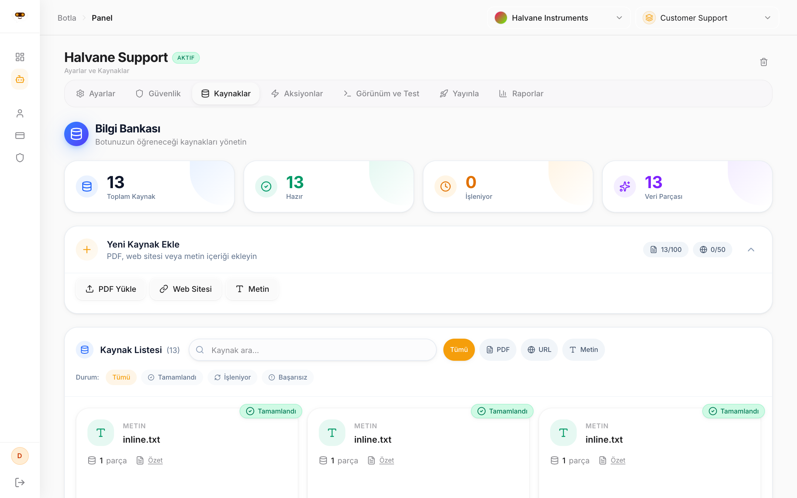
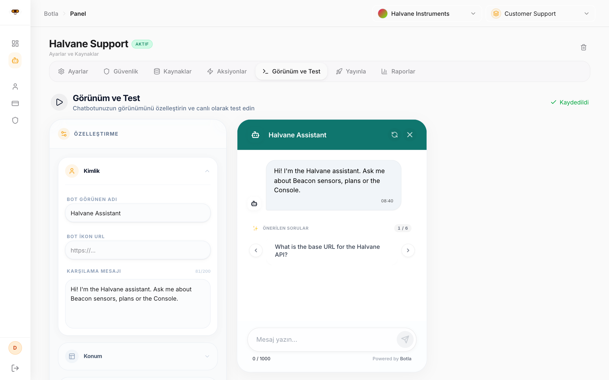
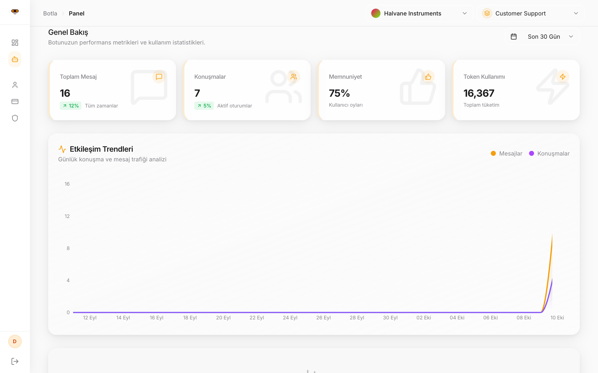
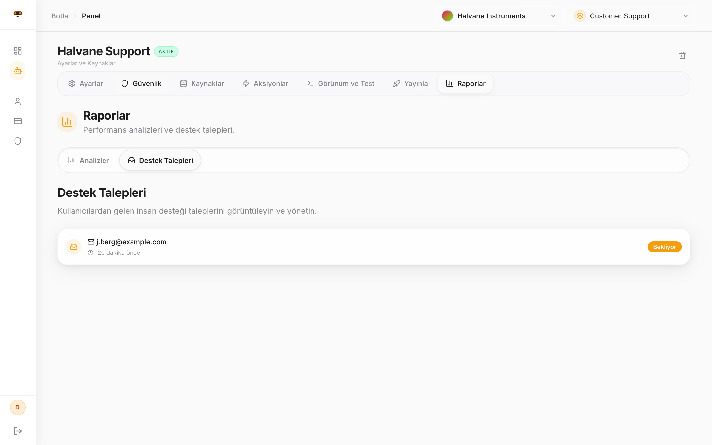
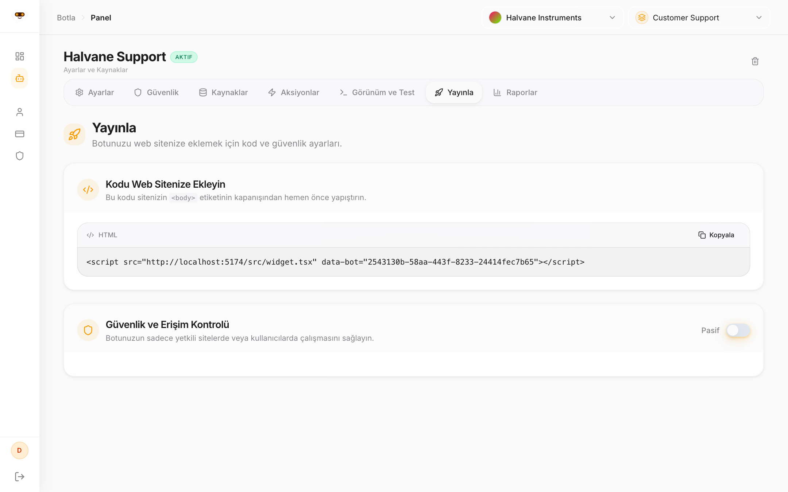
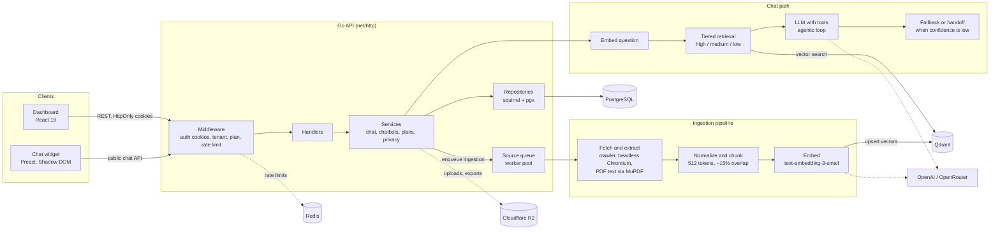
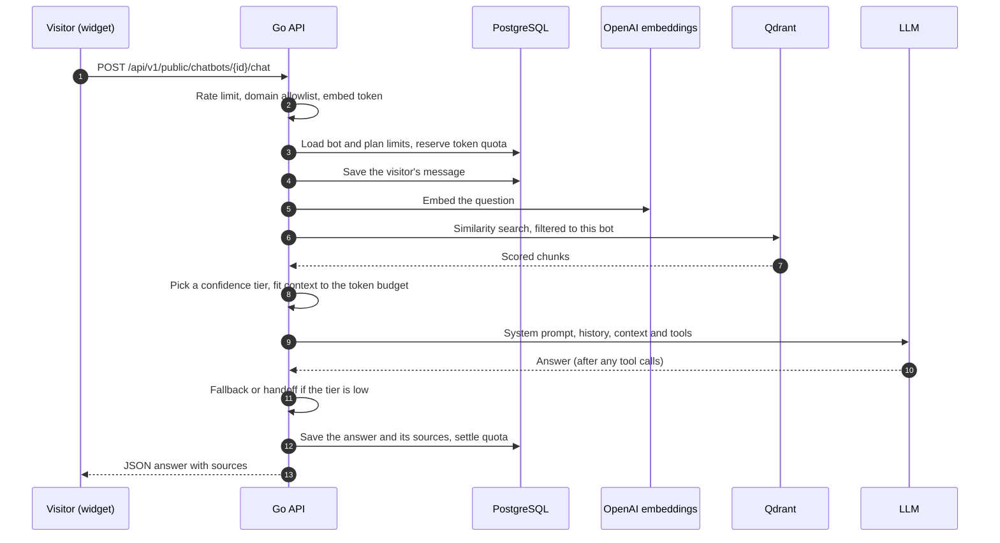

# Botla

**Turn a website, PDFs or plain text into a grounded support chatbot you can embed with one script tag.**

[](https://github.com/onurceri/botla/actions/workflows/go.yml)
[](https://github.com/onurceri/botla/actions/workflows/web.yml)
[](LICENSE)
[](go.mod)

Botla is a multi-tenant RAG chatbot platform. It crawls and extracts your content, chunks and embeds it into Qdrant, and answers visitor questions with an LLM that is given only the retrieved context. When retrieval confidence is low, it falls back to a refusal or a human handoff instead of guessing. The repo contains a Go API, a React dashboard for managing bots, an embeddable Preact widget, and an evaluation suite that scores answer quality with an LLM judge calibrated against human labels.

## Features

- **Ingestion**: single URLs, sitemap discovery with an approve/reject queue for the pages it finds, bulk URL import, PDF upload and raw text. Pages are fetched with a static crawler (colly) or a headless Chromium pool (go-rod) for JavaScript-heavy sites. Sources can be re-ingested on a schedule.
- **Retrieval**: sentence-aware chunking (512 tokens, ~15% overlap), OpenAI `text-embedding-3-small` embeddings with deterministic point IDs, and **tiered similarity search**: high, medium and low confidence tiers decide whether the bot answers normally, answers with a caveat, or falls back. Optional query decomposition for multi-part questions.
- **Grounded answers**: a guarded system prompt, per-bot guardrails and topic rules, and a configurable fallback (static message, restricted "smart" fallback, or escalation to a human).
- **Actions**: bots can call customer-defined HTTP actions through LLM function calling in an agentic loop, with execution logs.
- **Human handoff**: visitors can ask for a person and leave an email address. The requests appear in the dashboard.
- **Embeddable widget**: a Preact bundle rendered in a Shadow DOM, so host-page CSS can't leak in. Theming, suggested questions, feedback buttons, a per-bot domain allowlist and optional HMAC-signed embed tokens.
- **Multi-tenant SaaS core**: organizations, workspaces and roles; Free, Pro and Ultra plans with quotas, model access and feature gates enforced in one place; Redis-backed rate limiting; an admin panel for users, organizations, plans, queues and system health.
- **Analytics**: message volume, token usage, source usage and visitor feedback per bot.
- **Privacy**: KVKK/GDPR-style data export, correction and deletion requests, plus a scheduled retention job.
- **Measured quality**: a RAG eval suite with retrieval metrics, an LLM judge, judge-versus-human calibration and a regression gate ([see below](#rag-evaluation)).

## Screenshots

<table>
  <tr>
    <td width="50%"><br><sub>The widget on a customer site, answering a two-part question from the ingested docs</sub></td>
    <td width="50%"><br><sub>Chatbots in a workspace</sub></td>
  </tr>
  <tr>
    <td><br><sub>Knowledge base: ingested sources and their status</sub></td>
    <td><br><sub>Appearance settings with a live preview</sub></td>
  </tr>
  <tr>
    <td><br><sub>Analytics: messages, conversations, feedback and token usage</sub></td>
    <td><br><sub>Human handoff requests</sub></td>
  </tr>
  <tr>
    <td><br><sub>The embed snippet</sub></td>
    <td></td>
  </tr>
</table>

The dashboard UI is in Turkish. The demo data is fictional; `make screenshots` regenerates these images (see [CONTRIBUTING.md](CONTRIBUTING.md#readme-screenshots)).

## Architecture



Handlers stay thin and the business logic lives in `internal/services`. LLM calls go through a circuit breaker. [`AGENTS.md`](AGENTS.md) documents the layering, the middleware order and the background jobs, and [`docs/system/vector-indexing-pipeline.md`](docs/system/vector-indexing-pipeline.md) walks through ingestion step by step.

### A chat request



## Tech stack

| Layer | Technology |
|---|---|
| Backend | Go 1.25, `net/http`, squirrel query builder over pgx (no ORM) |
| Data | PostgreSQL, Redis 7, Qdrant |
| Object storage | Cloudflare R2 (S3-compatible), optional |
| AI | OpenAI embeddings and chat models, OpenRouter, gobreaker circuit breaker |
| Ingestion | colly, go-rod (headless Chromium), sitemap parser, go-fitz (MuPDF) for PDF text |
| Dashboard | React 19, Vite, TypeScript, TanStack Query, Tailwind CSS, Radix UI |
| Widget | Preact, Vite, TypeScript, Shadow DOM; deployed to Cloudflare Pages |
| Testing | Go `testing` and testify, Vitest, Testing Library, Playwright, a custom RAG eval harness |
| Ops | Docker, Docker Compose, Caddy, GitHub Actions, golang-migrate |

## Quick start

**Prerequisites:** Go 1.25+, Node.js 20.19+ with npm, Docker with Compose, and an OpenAI API key.

```bash
git clone https://github.com/onurceri/botla.git && cd botla

# 1. Configure (the defaults match the local Docker stack)
cp .env.example .env                  # then set OPENAI_API_KEY and JWT_SECRET
cp frontend/.env.example frontend/.env

# 2. Start PostgreSQL, Redis and Qdrant; the stack also applies the migrations
make up

# 3. Run the API on :8080
make be-run-no-pdf                    # or `make be-run` for PDF support (needs CGO and MuPDF)

# 4. In another terminal, install the JS workspaces and start the dashboard and widget
npm ci
npm run dev                           # dashboard on :5173, widget dev server on :5174
```

Open <http://localhost:5173>, register, create a chatbot, add a URL or some text, and try it in the playground. To reach the admin panel, promote your account with `make admin-promote email=you@example.com`.

To put a bot on a site, copy the snippet from the dashboard's deploy tab. It looks like this:

```html
<script src="https://<your-widget-host>/widget.js" data-bot="<chatbot-id>"></script>
```

## Configuration

The backend reads all settings from environment variables, loaded from `.env`. [`.env.example`](.env.example) lists every option with comments. The ones that matter first:

| Variable | Required | Purpose |
|---|---|---|
| `DB_HOST`, `DB_PORT`, `DB_NAME`, `DB_USER`, `DB_PASSWORD` | yes | PostgreSQL connection |
| `REDIS_URL` | yes | Rate limiting; the server won't start without it |
| `QDRANT_URL`, `QDRANT_API_KEY` | URL only | Vector database |
| `JWT_SECRET` | yes | Signs auth tokens; use 32+ random characters |
| `PORT` | yes | HTTP port |
| `OPENAI_API_KEY` | for chat | Embeddings and chat models |
| `OPENROUTER_API_KEY` | no | Route chat models through OpenRouter |
| `CORS_ALLOWED_ORIGINS` | no | Origins allowed to call the API with credentials |
| `R2_ACCOUNT_ID`, `R2_ACCESS_KEY_ID`, `R2_SECRET_ACCESS_KEY`, `R2_BUCKET_NAME` | no | Storage for uploads, privacy exports and tokenizer data |
| `RAG_TOPK`, `RAG_MAX_CONTEXT_TOKENS`, `RAG_QUERY_DECOMPOSITION` | no | Retrieval tuning |
| `GO_ENV` | no | `production` turns on Secure cookies and TLS to PostgreSQL |

The dashboard and widget take `VITE_*` variables; see `frontend/.env.example` and `widget/.env.example`.

## Project layout

```
.
├── cmd/
│   ├── server/        # API entrypoint and dependency wiring
│   ├── cli/           # Admin CLI (promote/demote platform admins)
│   └── eval/          # RAG eval runner
├── internal/
│   ├── api/           # Handlers, router, admin guards
│   ├── services/      # Business logic: chat pipeline, plans, privacy, handoff
│   ├── repository/    # SQL data access: interfaces, Postgres implementations, mocks
│   ├── rag/           # Chunking, embeddings, Qdrant client, tiered search, LLM clients
│   ├── processing/    # Source ingestion queue and per-type processors
│   ├── scraper/       # Crawler, sitemap parser, headless browser pool
│   ├── evals/         # Eval framework: dataset, metrics, judge, gate
│   ├── integration/   # Integration tests
│   └── ...            # auth, models, pdf, workers, testdb
├── pkg/               # config, middleware, ratelimit, storage, tokenizer, urlutil, logger
├── db/migrations/     # SQL migrations (golang-migrate)
├── api/openapi.yaml   # OpenAPI 3 spec
├── evals/             # Eval corpus, golden sets, judge rubrics, baseline
├── frontend/          # React dashboard
├── widget/            # Embeddable Preact widget
└── docs/              # Feature specs and system notes
```

## Testing

| Suite | Command | Notes |
|---|---|---|
| Go unit tests | `make test-fast` | Repository and service tests use the PostgreSQL from `make up` |
| Go checks | `make ci` | `go vet`, golangci-lint, then the tests |
| Go integration tests | `make test-integration-real` | Starts `docker-compose.integration.yml` (PostgreSQL, Redis, Qdrant), waits for it to be healthy and runs the suites; `make test-integration-down` removes it |
| Dashboard | `npm run ci --workspace=frontend` | ESLint, `tsc`, Vitest with coverage |
| Widget | `npm run ci --workspace=widget` | `tsc`, ESLint, Vitest with coverage |
| End-to-end | `npm run e2e --workspace=frontend`<br/>`npm run test:e2e --workspace=widget` | Playwright; start the dashboard dev server or build the widget first |
| RAG evals | `make eval-up && make eval` | Calls real models (`OPENAI_API_KEY`, or OpenRouter); a run costs a few cents |

GitHub Actions runs the [Go](.github/workflows/go.yml) and [web](.github/workflows/web.yml) workflows on pull requests and on pushes to `main`. Real-service integration tests run weekly.

### RAG evaluation

The [`evals/`](evals/README.md) suite drives Botla's real ingestion, retrieval and chat code over a fictional 13-document corpus and 45 golden cases (answerable, multi-hop, unanswerable and prompt-injection attacks), plus a 22-case held-out set. It reports retrieval metrics, including how much of the needed context actually reached the prompt, and uses an LLM judge with versioned rubrics for faithfulness, correctness, refusal and injection resistance.

The judge is measured as well. It is **calibrated against 21 human-labelled answers** (Cohen's kappa 0.90 on the current baseline), checked for consistency across repeats and probed for verbosity bias, and the gate fails if its kappa drops below 0.60. A **regression gate** compares each run with a recorded baseline using per-slice tolerances, and a GitHub workflow runs it on demand or on pull requests labelled `run-evals`. The eval README has the results, the multi-hop experiments and the known limitations.

```bash
make eval-test    # offline unit tests for the eval framework (no API keys)
make eval-quick   # single-repeat smoke run against real models
```

## Security

Please report vulnerabilities privately; [SECURITY.md](SECURITY.md) explains how and what is in scope. Built-in protections include HttpOnly cookie auth with refresh-token rotation, tenant scoping on authenticated routes, SSRF protection for URL ingestion, per-bot domain allowlists and signed embed tokens for the widget, security headers, and plan-aware rate limiting.

## Contributing

See [CONTRIBUTING.md](CONTRIBUTING.md) for setup, the checks to run and the commit style. [AGENTS.md](AGENTS.md) and the per-area `AGENTS.md` files describe the codebase conventions.

## License

Copyright (C) 2025-2026 Onur Ceri.

Botla is free software under the [GNU Affero General Public License v3.0 or later](LICENSE). If you run a modified version as a network service, the AGPL requires you to offer that version's source code to its users.
