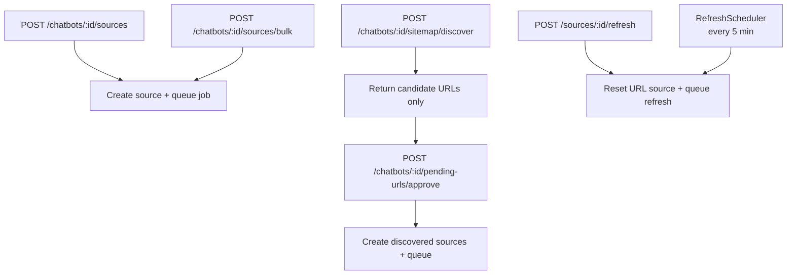
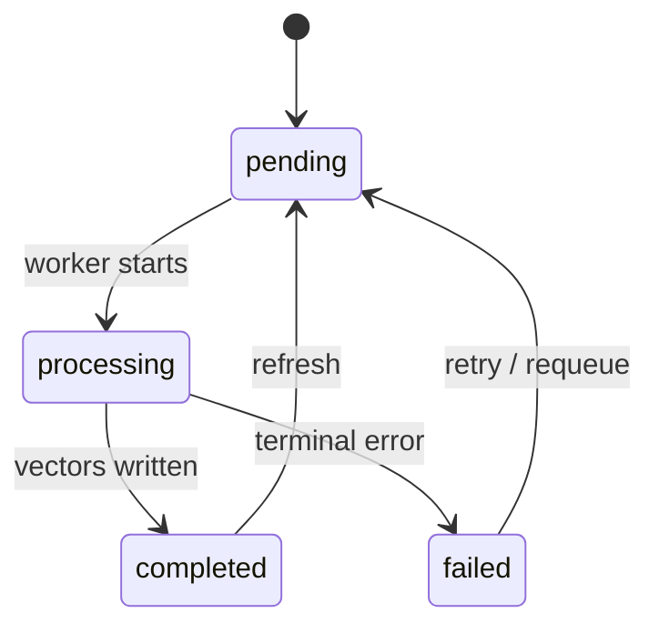
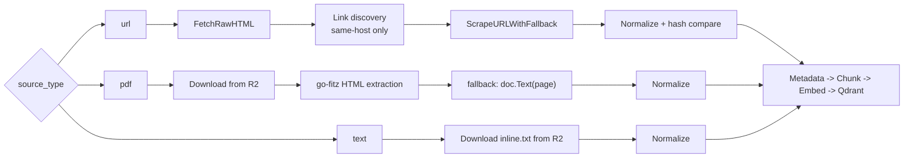

# Vector Indexing Pipeline

This is the shortest useful mental model for Botla ingestion: a source is saved in Postgres, turned into a background job, processed into chunks, embedded with OpenAI, and upserted into Qdrant.

## At a glance

| Stage | Main code | What it decides |
| --- | --- | --- |
| Source creation | `internal/api/handlers/*source*` | Quotas, SSRF checks, dedupe, storage upload, initial enqueue |
| Async orchestration | `internal/processing/sources_queue.go`, `job_processor.go` | `training_jobs`, retries, worker dispatch, status transitions |
| Source parsing | `url_processor.go`, `pdf_processor.go`, `text_processor.go` | Scraping, PDF extraction, normalization, metadata extraction |
| Chunking and token heuristics | `internal/rag/chunker.go`, `tokens.go`, `pkg/tokenizer/*`, `pkg/langconfig/*` | Sentence boundaries, 512-token target, Turkish-specific behavior |
| Embedding and index write | `internal/rag/embedding.go`, `qdrant.go` | `text-embedding-3-small`, batch size 25, Qdrant payload and indexes |
| Retrieval assumptions | `internal/rag/search.go` | TopK, context-token budget, similarity thresholds |

## 1. Pipeline in one picture

```mermaid
flowchart LR
    A["Source API<br/>create / bulk / approve / refresh"] --> B["data_sources<br/>status=pending"]
    B --> C["training_jobs<br/>status=pending"]
    C --> D["SourceQueue / QueueManager"]
    D --> E["JobProcessor"]
    E --> F["Fetch + parse source"]
    F --> G["NormalizeTR"]
    G --> H["ExtractIngestionMetadata<br/>summary + suggested questions"]
    H --> I["ChunkText<br/>target=512 tokens<br/>overlap≈15%"]
    I --> J["EmbeddingService<br/>25 chunks/batch<br/>~58 req/sec soft cap"]
    J --> K["Qdrant: embeddings<br/>1536 dims / cosine"]
    K --> L["source completed<br/>usage + metadata updated"]
```

**What persists where**

| Store | Purpose |
| --- | --- |
| Postgres `data_sources` | Source identity, status, content hashes, refresh flags, metadata |
| Postgres `training_jobs` | Async job lifecycle and retries |
| R2 / object storage | Uploaded PDFs and inline text blobs |
| Qdrant `embeddings` | Chunk vectors plus payload used for search and deletion |

## 2. How work enters the pipeline

> **Important:** `sitemap/discover` is discovery-only. It fills `pending_discovered_urls`; it does **not** create `data_sources` or `training_jobs`.

**Normal path**

1. Handler validates plan limits, source count, and source-specific rules.
2. Source is saved in `data_sources`.
3. `SourceQueue.EnqueueSource(...)` creates a `training_jobs` row and puts the source on the queue.
4. Workers pick the source and route it to the correct processor.

## 3. State model

| Record | Main statuses | Why it exists |
| --- | --- | --- |
| `data_sources` | `pending`, `processing`, `completed`, `failed` | User-facing source lifecycle |
| `training_jobs` | `pending`, `processing`, `completed`, `failed` | Background execution, retries, audit trail |

**Worker behavior**

- Queue defaults: `maxWorkers=16`, `bufferSize=64`.
- Failed jobs are retried up to 3 times with exponential backoff.
- On startup, pending and processing jobs are recovered back into the queue.

## 4. Source-type branches

| Source type | Path | Important behavior |
| --- | --- | --- |
| URL | `internal/processing/url_processor.go` | SSRF-safe creation, raw HTML for discovery, scraper fallback, unchanged-content refresh skip |
| PDF | `internal/processing/pdf_processor.go` | Uploaded file hash dedupe, `go-fitz` HTML extraction first, plain-text fallback |
| Text | `internal/processing/text_processor.go` | Inline text stored as `inline.txt`, then processed like a file-backed source |

### URL-specific decisions

- Discovery keeps only same-host links.
- Discovery depth is effectively one level because discovered sources (`IsDiscovered=true`) do not crawl again.
- Refresh compares a normalized-content SHA-256 hash. If the content is unchanged and chunks already exist, reindexing is skipped.
- On changed refreshes, old Qdrant points for the source are deleted before new vectors are written.

## 5. Chunking and Turkish-specific behavior

| Decision | Current behavior | Why it matters |
| --- | --- | --- |
| Sentence splitting | Language-specific tokenizer data, with English fallback and then regex fallback | Better chunk boundaries than pure regex |
| Target size | `512` estimated tokens | Main chunk size used by ingestion |
| Overlap | About `15%` tail overlap | Preserves continuity across chunks |
| Token counting | `round((runes / 4) * multiplier)` | This is a heuristic, not a model tokenizer |
| Turkish multiplier | `1.3` | Turkish text is treated as denser than English |
| English multiplier | `1.0` | Baseline heuristic |

**Turkish details**

- Tokenizer training data is loaded by `pkg/tokenizer.Loader`.
- Production fetches language models from object storage under `system/tokenizer/<lang>.json`.
- Turkish sentence splitting also protects known abbreviations from `pkg/langconfig/config.go` before splitting, then restores them afterward.
- If no language config is found, English defaults are used.

> **Important:** the code has a real sentence tokenizer, but token counting is still heuristic. `CountTokens(...)` is not tied to the OpenAI embedding model tokenizer.

> **Important:** processors call `text.NormalizeTR(...)` before chunking. That normalization collapses whitespace with `strings.Fields(...)`, so blank-line paragraph boundaries are often gone before `ChunkText(...)` sees the text.

## 6. Metadata extraction, embeddings, and index shape

| Layer | Current choice | Notes |
| --- | --- | --- |
| Metadata extraction | `ExtractIngestionMetadata(...)` | Generates `capability_summary` and suggested questions |
| Summary/question cap | 4000 chars, normalized question list | Keeps payload bounded |
| Embedding model | `text-embedding-3-small` | 1536 dimensions |
| Embedding batching | 25 chunks per request batch | Throughput tradeoff |
| Embedding retries | 4 attempts, exponential backoff from `200ms` | Handles transient OpenAI failures |
| Rate limiting | ~58 requests/sec soft cap | Avoids API bursts |
| Qdrant collection | `embeddings` | Created on startup if missing |
| Distance metric | Cosine | Current search metric |
| Payload indexes | `chatbot_id`, `source_id` | Faster filtered lookup and deletion |

**Qdrant payload shape**

Each point stores the vector plus payload fields such as:

- `chunk_text`
- `chatbot_id`
- `source_id`
- `source_name`
- `source_type`
- `chunk_index`
- `capability_summary`
- `suggested_questions`

That payload is why the system can:

1. Filter search by chatbot.
2. Delete or refresh a single source cleanly.
3. Inspect indexed chunks from the API.

## 7. Retrieval assumptions that influence indexing

| Setting | Current behavior |
| --- | --- |
| Search thresholds | high `0.50`, medium `0.30`, low tier ignored for RAG context |
| Context assembly | accepted chunks are joined with `\n---\n` |
| Plan-driven budget | retrieval uses plan-specific `TopK` and `MaxContextTokens` |
| Default plans | Free `3 / 2000`, Pro `5 / 4000`, Ultra `10 / 8000` |

This matters because chunk size was chosen for retrieval budgets, not just ingestion convenience.

## 8. Plan limits that also affect ingestion

| Plan | URLs / bot | Max crawl pages | Refresh |
| --- | --- | --- | --- |
| Free | 1 | 5 | Disabled |
| Pro | 10 | 50 | Enabled |
| Ultra | 50 | 200 | Enabled |

The pipeline is not purely technical; plan limits directly decide how much content can ever reach the index.

## 9. Current caveats engineers should know

1. `normalizeSuggestions(...)` effectively caps ingestion-time suggested questions at 6, even though some plans allow more.
2. `SearchContextTiered(...)` currently budgets context with `CountTokens(next, "tr")`, even for non-Turkish bots.
3. `PendingURLsHandlers.ApprovePendingURLs` and `RefreshScheduler.QueueRefreshForChatbot` currently queue source IDs directly with `Queue.Enqueue(...)` instead of creating a fresh `training_jobs` row through `SourceQueue.EnqueueSource(...)`.
4. PDF ingestion depends on the `fitz` build path; without it, the stub extractor leaves PDF processing unavailable.

## 10. Useful code map

Primary files to read first

| File | Why it matters |
| --- | --- |
| `cmd/server/main.go` | Startup wiring for Qdrant, tokenizer preload, processing queue, refresh scheduler |
| `internal/api/handlers/source_create.go` | Main create flow for URL, PDF, and text sources |
| `internal/api/handlers/source_refresh.go` | Manual URL refresh path and gating |
| `internal/api/handlers/pending_urls.go` | Approval path for discovered URLs |
| `internal/processing/sources_queue.go` | Source enqueue and job creation |
| `internal/processing/job_processor.go` | Worker dispatch, retries, recovery, completion |
| `internal/processing/url_processor.go` | Crawl/scrape/hash/refresh behavior |
| `internal/processing/pdf_processor.go` | PDF download and extraction |
| `internal/processing/text_processor.go` | Inline text processing |
| `internal/rag/chunker.go` | Chunk sizing and overlap logic |
| `internal/rag/tokens.go` | Token heuristic |
| `internal/rag/embedding.go` | OpenAI embedding batching and retries |
| `internal/rag/qdrant.go` | Collection schema, payload indexes, search/delete helpers |
| `internal/rag/search.go` | Retrieval thresholds and context assembly |
| `pkg/tokenizer/loader.go` | Sentence tokenizer loading |
| `pkg/langconfig/config.go` | Turkish/English config and abbreviations |
| `db/migrations/000001_init.up.sql` | Canonical schema and plan defaults |

Useful operational endpoints

| Endpoint | What it is for |
| --- | --- |
| `POST /api/v1/chatbots/{id}/sources` | Create URL, PDF, or text source |
| `POST /api/v1/chatbots/{id}/sources/bulk` | Bulk URL creation |
| `POST /api/v1/chatbots/{id}/sitemap/discover` | Discover candidate URLs without indexing them |
| `POST /api/v1/chatbots/{id}/pending-urls/approve` | Turn discovered URLs into real sources |
| `POST /api/v1/sources/{id}/refresh` | Requeue a URL source for refresh |
| `GET /api/v1/chatbots/{id}/sources/{source_id}/chunks` | Inspect indexed chunks |

